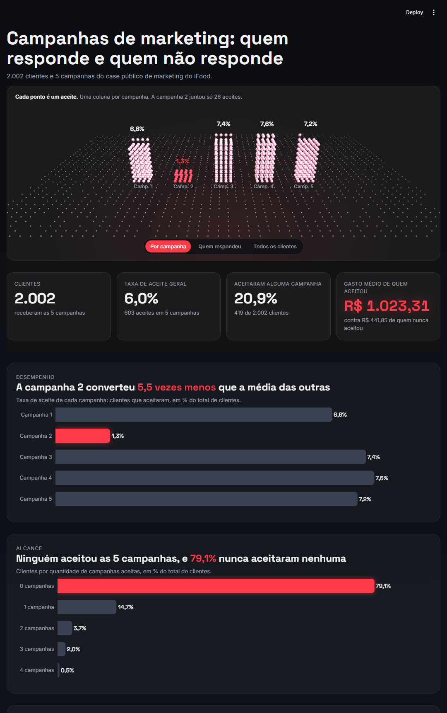
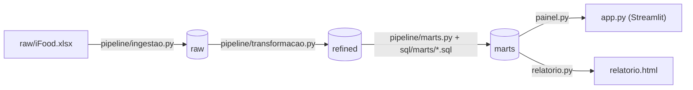

# Campanhas de marketing do iFood: quem responde e quem não responde

Pipeline de dados em Python e DuckDB sobre o case público de marketing do iFood: lê a planilha, limpa, organiza em camadas e publica um painel com os achados.

## A pergunta de negócio

Quem responde às campanhas de marketing e quem não responde.

## Resultados

Base: 2.002 clientes e 5 campanhas. A taxa de aceite geral é de 6,0% (603 aceites).

- **A campanha 2 foi a pior.** Teve 1,3% de aceite, 5,5 vezes menos que a média das outras quatro, que ficaram entre 6,6% e 7,6%.
- **79,1% dos clientes nunca aceitaram nenhuma campanha** (1.583 de 2.002). Ninguém aceitou as 5. Só 419 clientes (20,9%) aceitaram pelo menos uma.
- **Quem aceita gasta 2,3 vezes mais.** O gasto médio em 2 anos é de R$ 1.023,31 para quem aceitou alguma campanha, contra R$ 441,85 de quem nunca aceitou.
- **Filhos.** Cliente sem filhos tem taxa de aceite de 12,3%, contra 3,5% de quem tem filhos: 3,5 vezes mais.
- **Renda.** A faixa acima de 75 mil tem a maior taxa de aceite, 19,1%. A faixa até 35 mil tem 1,6%.
- **Escolaridade.** Doutorado tem a maior taxa (6,8%), 3,3 vezes a do básico (2,0%). Graduação (6,2%) e mestrado (5,5%) ficam perto do doutorado.



## Arquitetura



- **raw:** espelho fiel da planilha, sem nenhuma decisão. `raw.clientes_campanhas` tem 2.205 linhas e 29 colunas, todas como texto.
- **refined:** dado limpo, tipado e sem duplicatas. `refined.clientes` tem uma linha por cliente (2.002). `refined.respostas_campanhas` tem uma linha por cliente em cada campanha (10.010).
- **marts:** uma tabela por pergunta, com os números prontos: `desempenho_campanhas`, `alcance`, `gasto_por_resposta`, `perfil_aceite` e `resumo`.
- **painel:** `app.py` e `relatorio.html` só fazem SELECT nos marts. Nenhum número é calculado no painel.

Tudo fica num único arquivo DuckDB, `ifood.duckdb`, que não vai para o Git e é recriado pelo pipeline.

## Decisões tomadas sobre o dado

- **Duplicatas.** 203 linhas eram idênticas a outra em todas as 28 colunas, exceto o Index. Foram tratadas como o mesmo cliente cadastrado duas vezes, e fica a de menor Index. As 2.205 linhas viram 2.002 clientes.
- **Escolaridade.** "2n Cycle" (198 clientes) e "Master" (364 clientes) foram juntados como mestrado. "2n Cycle" é o nome europeu do mestrado.
- **Campanhas em linhas.** As 5 colunas AcceptedCmp1 a AcceptedCmp5 viram a tabela `respostas_campanhas`, com 10.010 linhas (2.002 clientes × 5 campanhas). Assim dá para agrupar por campanha e fazer JOIN com o perfil do cliente.
- **AcceptedCmpOverall descartada.** Antes de descartar, o pipeline confere que ela é igual à soma das 5 campanhas. Ela bate em todas as linhas e pode ser recalculada quando precisar.

## Limitações

- O dado não diz quem recebeu cada campanha, só quem aceitou. Os indicadores assumem que todos os clientes receberam as 5.
- O gasto é o total de 2 anos do cliente, sem ligação com nenhuma campanha. A comparação de gasto mostra relação, não causa.
- Não dá para medir venda gerada por campanha, porque o dado não liga compra a campanha.

## Como rodar

Pré-requisito: [uv](https://docs.astral.sh/uv/).

```bash
uv sync
uv run python -m pipeline.ingestao        # raw.clientes_campanhas: 2.205 linhas, 29 colunas
uv run python -m pipeline.transformacao   # remove 203 duplicatas; 2.002 clientes e 10.010 respostas
uv run python -m pipeline.marts           # grava os 5 marts
uv run pytest
uv run ruff check .
uv run streamlit run app.py
uv run python relatorio.py                # gera relatorio.html
```

Se o `ifood.duckdb` não existir, o `app.py` roda ingestão, transformação e marts sozinho antes de abrir a tela.

## Estrutura de pastas

```
.
├── raw/iFood.xlsx            planilha original (Kaggle, CC0)
├── pipeline/
│   ├── db.py                 conexão com o DuckDB
│   ├── ingestao.py           planilha -> raw
│   ├── transformacao.py      raw -> refined
│   └── marts.py              executa os SQL de sql/marts/
├── sql/marts/                01 a 05, um SELECT por mart
├── painel.py                 leitura, formatação e gráficos do painel
├── app.py                    painel em Streamlit
├── relatorio.py              gera relatorio.html
├── tests/                    testes com dados inventados
├── specs/                    as specs de cada etapa
└── docs/img/                 print do painel
```

## Testes

São 14 testes (`uv run pytest`), um arquivo por etapa:

- **Ingestão (4):** toda coluna chega como texto, célula vazia vira nulo e "NA" continua "NA", rodar duas vezes não duplica, planilha ausente para sem criar o banco.
- **Transformação (6):** duplicata fica com o menor Index, cada cliente gera 5 respostas, "2n Cycle" e "Master" viram mestrado, escolaridade desconhecida para tudo sem criar refined, valor fora de "0" e "1" nas campanhas para tudo, AcceptedCmpOverall diferente da soma para tudo.
- **Marts (4):** as somas de aceites e de clientes fecham com o total nos marts de desempenho, alcance e perfil, e um SQL que devolve zero linhas é erro.

Cada teste cria seu próprio banco e seus próprios arquivos numa pasta temporária, com poucas linhas inventadas. Nenhum teste abre o `ifood.duckdb` nem lê a planilha.

Para conferir que os testes pegam erro de verdade, quebrei uma regra de propósito: tirei "2n Cycle" do mapa de escolaridade. O teste `test_2n_cycle_e_master_viram_mestrado` ficou vermelho. Depois desfiz a quebra.

## Fonte dos dados e licença

Dataset "iFood Marketing Campaigns Analysis", no Kaggle, com licença CC0. Projeto de estudo, sem relação oficial com o iFood.

## Onde a IA errou ou assumiu algo que eu não pedi

Construí o projeto com spec-driven development: eu escrevia a spec, a IA implementava e no fim listava o que tinha assumido. Estes foram os casos em que algo saiu diferente do que eu pedi.

**Versão do Python.**
As specs pediam Python 3.12, mas o projeto roda em 3.13. O `uv init` com `--python 3.12` virou "3.12 ou mais novo", e o uv escolheu o mais novo sem avisar.
Descobri lendo a saída do pytest, que mostrava Python 3.13.

**Arredondamento silencioso.**
O CAST do DuckDB transforma "1.5" em 2 sem erro, o que contraria a regra da spec de parar quando a conversão falha. Hoje os dados não têm casas decimais, então nada mudou, mas a regra não está garantida.
Quem apontou foi a própria IA, na lista do que assumiu.

**Regra "só lê de refined" não verificada.**
A spec dos marts dizia que eles só leem de refined, mas o executor não confere isso. Um SQL que lesse de raw passaria.
Também apareceu na lista do que a IA assumiu.

**Rótulos sem acento.**
A spec pedia os nomes do mart com a primeira letra maiúscula, e a IA seguiu ao pé da letra, gerando "Ate 35k" e "Basico".
Descobri lendo a lista do que ela assumiu, e a regra virou um mapa de rótulos na spec.

**Spec cortada.**
Na etapa do dashboard, o texto que colei no chat chegou cortado no meio. A IA parou e pediu o resto em vez de inventar.
Percebi pela resposta dela, e passei a entregar as specs como arquivo.

**O arquivo do Kaggle.**
A página do dataset dizia `ifood_df.csv`, mas o download trouxe `iFood.xlsx`.
Descobri ao tentar contar as linhas do CSV e o arquivo não existir.

O hábito que mais pegou erro foi contar antes e depois de cada etapa: linhas lidas, linhas gravadas, somas que tinham que fechar.

## Autor

Jean Vinicius
GitHub: [github.com/jeanvinicius-dataeng](https://github.com/jeanvinicius-dataeng)
LinkedIn: [linkedin.com/in/jeanvinicius](https://linkedin.com/in/jeanvinicius)

- Painel publicado: [link]
- Relatório: [link]
